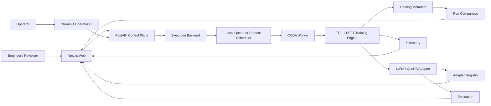
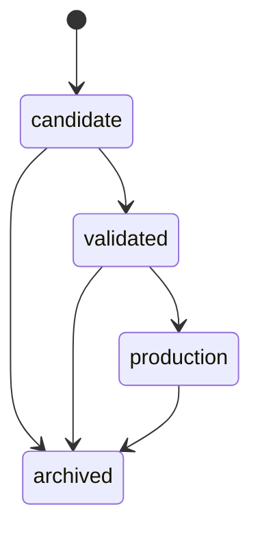

# TuneForge System Design

## System context

## Control plane

The FastAPI layer owns:

- experiment validation
- workspace-scoped run metadata
- adapter metadata access
- comparison endpoints
- deterministic evaluation checks
- queue submission through an execution-backend interface
- lifecycle actions

It does not perform GPU training inside the HTTP request.

## Data plane

A TuneForge worker claims a job and invokes the reusable training CLI.

The worker owns the long-running training process and produces:

- logs
- telemetry.jsonl
- run_metadata.json
- final adapter directory
- adapter registry record

## Execution backend

The control plane depends on a small contract:

- submit
- cancel
- retry
- snapshot

Reference implementations:

1. local-filesystem — useful for reproducible local development
2. remote-webhook — forwards execution to an external scheduler or GPU service

This boundary prevents a future cloud/GPU provider decision from leaking throughout the product.

## Model adaptation

### LoRA

Load the base model at the hardware-appropriate floating-point precision, freeze the base, and inject low-rank adapters into configured target modules.

### QLoRA

Load the base model in 4-bit NF4 with double quantization, prepare it for k-bit training, and train LoRA adapters on top of the quantized base representation.

## Evaluation

TuneForge separates:

### Training evidence

- training loss
- steps
- effective batch size
- parameter counts
- GPU / precision

### Runtime evidence

- latency
- generated token count
- tokens per second
- word count
- repetition ratio

### Deterministic task checks

- minimum / maximum response length
- required terms
- forbidden terms
- regex constraints

These checks are auditable, but they are not a substitute for semantic benchmarks, domain review, factuality evaluation, or safety evaluation.

## Artifact lifecycle

A successful training job produces a candidate—not an automatically production-ready model artifact.

## Scaling path

The reference implementation is intentionally replaceable.

| Reference component | Production evolution |
|---|---|
| JSON run files | PostgreSQL |
| Filesystem queue | Redis / SQS / PubSub |
| Local adapter files | S3 / GCS / Azure Blob |
| API key | OIDC / enterprise IAM |
| Workspace metadata | tenant-isolated authorization |
| JSONL telemetry | OpenTelemetry + metrics/log backend |
| Local worker | autoscaled GPU worker pool |
| local process status | leases, heartbeats, idempotency |
| deterministic rules | benchmark suites + human/LLM judges |

## Failure modes considered

- no CUDA worker available
- invalid quantization mode
- T4 BF16 incompatibility
- malformed custom dataset
- missing required dataset fields
- job failure and retry
- pre-execution cancellation
- corrupt registry/run files
- invalid adapter promotion
- API key mismatch
- invalid workspace identifier

## Deliberate gaps

TuneForge does not currently claim:

- enterprise-grade tenant isolation
- production-safe running-job termination
- automatic semantic quality improvement
- safety certification
- fully managed cloud GPU scheduling
- production model serving

These are explicit roadmap items, not hidden assumptions.
